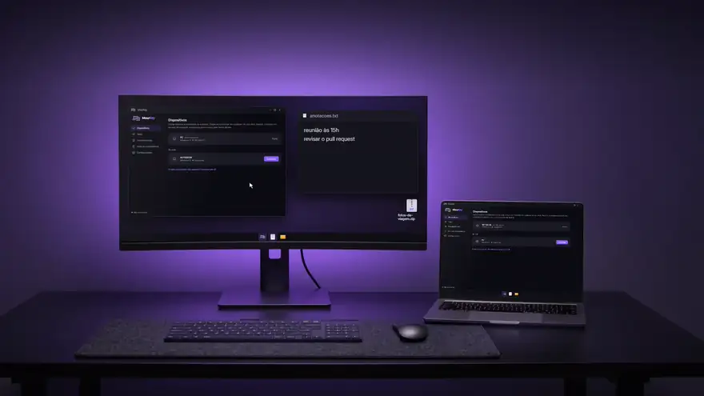

<p align="center">
  <picture>
    <source media="(prefers-color-scheme: dark)" srcset="assets/logo/svg/horizontal/moukey-horizontal-fundo-escuro.svg" />
    
  </picture>
</p>

<p align="center"><a href="https://github.com/Nando1N/moukey/actions/workflows/testes.yml"></a></p>

<p align="center"><b>Um mouse, um teclado, todos os seus computadores.</b><br />Use o mesmo mouse e teclado em dois computadores, sem configurar nada.</p>

<p align="center"></p>

## Como usar

**[Baixe o MouKey.exe](https://github.com/Nando1N/moukey/releases/latest)** (Windows 10 e 11). Não precisa instalar nada.

O exe não tem assinatura digital, então na primeira vez o Windows mostra "O Windows protegeu o computador". Clique em **Mais informações** e depois em **Executar assim mesmo**. O exe é gerado aqui no GitHub a partir deste código, e o hash para conferir está na página do download.

1. Abra o MouKey nos dois computadores.
2. Em qualquer um deles, clique em **Conectar** no outro computador da lista.
3. No outro, confira se o código de 6 dígitos é o mesmo e clique em **Confirmar e parear**.

Pronto. Leve o mouse até a borda da tela e ele passa para o outro computador. Funciona dos dois lados: o mouse de qualquer um dos dois controla o outro.

Se o firewall perguntar, clique em **Permitir**.

Se algo travar, aperte `Ctrl+Alt+Shift+Esc` e o mouse volta na hora.

## O que já funciona

- mouse, cliques e rodinha passando pela borda da tela, nos dois sentidos
- vários monitores: a tela **Telas** mostra todos os monitores dos dois computadores no tamanho real, e você arrasta o outro computador para onde ele fica na mesa
- teclado junto, com atalhos (Ctrl+C, Ctrl+V, Alt+Tab), acento e Ç
- Ctrl+C num computador e Ctrl+V no outro, com texto, prints, imagens e arquivos (até 200 MB por vez), e histórico do que foi copiado
- mandar arquivos de um computador para o outro arrastando para a janela, escolher a pasta onde eles chegam e abrir o arquivo recebido direto na pasta
- um acha o outro sozinho na rede, sem digitar IP (e dá para digitar o IP se a rede bloquear a busca)
- reconecta sozinho quando você abre de novo ou a rede volta
- fica no ícone perto do relógio, fechar a janela não desliga

Testado entre dois computadores com Windows 11, um deles com dois monitores.

### Experimental

- **Linux com X11**: manda e recebe mouse e teclado, nos dois sentidos. Os testes rodam num X11 virtual a cada mudança, mas ainda falta gente testando em computadores de verdade. Wayland ainda não funciona.
- macOS: ainda não.

Se você testar no Linux, conta como foi numa issue. Ajuda muito.

## Segurança

O MouKey lida com mouse e teclado, então isso foi pensado desde o começo:

- tudo que passa entre os computadores é criptografado (X25519 + ChaCha20-Poly1305)
- um computador novo só conecta depois que você confirma o mesmo código de 6 dígitos nos dois
- só aceita conexões da rede local
- não grava o que você digita, nem em arquivo nem em log
- arquivos recebidos são conferidos (SHA-256) e salvos em `Downloads\MouKey` (ou na pasta que você escolher), nunca abertos sozinhos

Detalhes e como reportar um problema em [SECURITY.md](SECURITY.md).

## Limitações conhecidas

- janelas abertas como administrador no Windows não recebem o mouse de outro programa (regra do Windows)
- o cursor pode não aparecer no computador que não tem mouse físico ligado (outra regra do Windows)
- redes de empresa, faculdade ou hotel às vezes bloqueiam a busca e o contato entre aparelhos
- os dois computadores precisam estar com a mesma versão do MouKey

## Por que fiz

Tenho um PC e um notebook na mesa e cansei de ficar trocando de mouse. As opções que achei pediam IP, arquivo de configuração ou chave pra digitar, então resolvi fazer uma que fosse só abrir e clicar.

## Rodar pelo código

Precisa de Python 3.11 ou mais novo.

```
pip install -e ".[dev]"
python -m moukey            # abre a janela
pytest                      # testes
ruff check . && ruff format --check .
```

No Linux, por enquanto, é só pelo código. Para gerar um executável só para você no Windows: `pip install pyinstaller` e depois `.\scripts\build-exe.ps1`.

Como o código está organizado em [docs/arquitetura.md](docs/arquitetura.md). Quer ajudar? Veja o [CONTRIBUTING.md](CONTRIBUTING.md).

---

**English:** share one mouse and keyboard between your computers on the same network. [Download MouKey.exe](https://github.com/Nando1N/moukey/releases/latest) (unsigned, so SmartScreen will warn you: More info → Run anyway) or run it from source (`python -m moukey`) on both, click **Conectar** on one and confirm the 6 digit code on the other. Multiple monitors, shared clipboard and file transfer included. Copy text, screenshots, images or files on one and paste on the other. Windows for now, Linux (X11) works as an experiment (text only on the clipboard).

Licença MIT.
